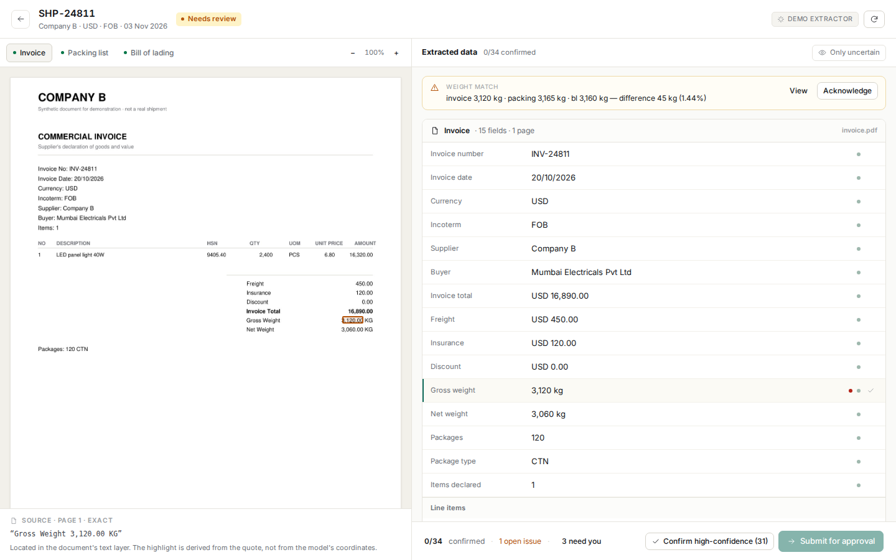

# Customs-AI

**Document intake, cross-document verification and human approval for import shipments.**

A freight forwarder receives an invoice, packing list and bill of lading as PDFs, scans and phone photos. An executive retypes them into the customs filing software, and 3% of shipments carry an error into filing. Customs-AI extracts the data, proves where every value came from, finds contradictions across the three documents, and refuses to export anything a person has not cleared.



---

## What it does

```
upload 3 documents → extract with evidence → cross-check → review → approve → CSV
```

- **Upload** invoice, packing list and bill of lading — PDF, JPG or PNG. Files go to private storage; the API validates type, size and page count.
- **Extract** parties, invoice number/date, currency, Incoterm, line items with HSN, packages, weights and containers. Every field carries a quote, a page and a confidence score.
- **Cross-check** 13 rules: line arithmetic, invoice total, quantities, packages, gross weight across all three documents, ISO 6346 container checksums, party names, currency, Incoterms, dates and document completeness.
- **Review** side by side. Selecting a field highlights the exact rectangle on the document and shows the source quote.
- **Correct line items** — description, HSN, quantity, unit price and amounts are editable with per-line evidence and confidence; edits rerun every check.
- **History** — every upload, correction, check decision, approval and export in one per-shipment timeline.
- **Manage documents** — re-extract or remove a document and rerun the checks; blocked once approved.
- **Gate** on uncertainty. Low-confidence fields and every failed check must be cleared by a named person; a manager approves; any edit after approval voids it.
- **Export** a CSV in a configurable filing-software layout, with a preview and a hard server-side gate.
- **Edit the export template** — managers change headers, sources, formats and required columns; saving creates a new version without touching old exports.
- **Measure** correction rate by field and supplier, first-pass acceptance and evidence coverage.

The design decision that matters: **the model proposes, the evidence caps, the checks contradict, the human decides.** A high confidence score never suppresses a mismatch.

---

## Demo

| Role | Email | Password |
|---|---|---|
| Documentation executive | `exec@demo.local` | `demo-exec-2026` |
| Documentation manager | `manager@demo.local` | `demo-manager-2026` |

Nine seeded shipments cover the happy path and the failure modes: a 45 kg weight mismatch (SHP-24811), a clean EUR shipment, a bilingual Chinese invoice, a scanned packing list, a missing bill of lading, an illegible page, a package-count mismatch, an approved shipment and one awaiting approval.

Open **SHP-24811** first. The weight warning is already there.

---

## Stack

| Layer | Choice |
|---|---|
| API | FastAPI, Pydantic v2, SQLAlchemy 2.0, Alembic |
| Database | PostgreSQL 16 |
| Documents | PyMuPDF (render + word-level boxes), Pillow |
| AI | Vertex AI Gemini adapter; deterministic fixture extractor locally |
| Storage | S3 (`ap-south-1`) in production, local disk for development |
| Web | React 19, TypeScript, Vite, custom CSS design system |
| Tests | pytest (31), Playwright (3 end-to-end paths) |

No Docker is required for local development: `scripts/dev_db.py` runs a bundled PostgreSQL binary.

---

## Run it

Full step-by-step instructions, environment variables and deployment notes: **[deployment.md](deployment.md)**.

```bash
# terminal 1 — database
cd api && uv sync
uv run python ../scripts/dev_db.py

# terminal 2 — schema, demo PDFs, extraction
uv run python ../seed/generate.py
uv run python ../seed/seed_demo.py
uv run uvicorn app.main:app --reload --port 8000

# terminal 3 — web
cd web && pnpm install && pnpm dev
```

Open **http://localhost:5173**.

---

## Tests

```bash
cd api && uv run pytest -q          # 31 backend tests
cd web && pnpm test:e2e             # upload → review → approve → export, manual entry, blocked export
cd api && uv run python ../eval/run.py
```

The evaluation harness compares 260 extracted fields across 24 synthetic documents against a generated golden set:

```
fields compared 260 · exact match 260/260 (100.0%)
Evidence: EXACT 260
Manual entry documents: 2 (SHP-24813 packing, SHP-24816 bl)
Missing documents: 1 (SHP-24815 bl)
```

**Read that number honestly.** It measures the deterministic fixture extractor on synthetic documents, not Gemini on real ones. The harness is the mechanism that would measure the real 200-shipment set in week 3 of the pilot.

---

## Repository

```
api/            FastAPI app, models, extraction, checks, migrations, tests
web/            React SPA, design system, Playwright tests
seed/           synthetic PDF generator and demo seeding
eval/           golden-set harness and results
docs/           phase plan, screenshots, build notes
TDD.md          technical design document
deployment.md   runbook
```

---

## What is real, and what is not

| Real | Not in this slice |
|---|---|
| Upload, validation, rendering, evidence | Vertex AI extraction without credentials (adapter present) |
| 13 cross-document checks and the gate | Durable job queue (extraction runs as an in-process background task) |
| Corrections, approvals, audit trail, line-item edits | Scheduled retention job (CLI exists) |
| Configurable CSV export | Excel `.xlsx` — waiting on the client's real template |
| Reports, settings, roles | Importer portal, HSN classification, duty, customs filing |

The filing-software column map is seeded with a plausible Shipping Bill layout because the client's actual template was not available. The mapping is data, not code; replacing it does not touch extraction or checks.

Two honest limits from the brief:

1. **95% accuracy on 200 shipments cannot be proven in seven days.** The harness exists; the 200 real documents are the next input.
2. **The ₹70.29 lakh figure is the client's assumption arithmetic, not a promised saving.** The system addresses retyping and undetected inconsistency; the amendment-rate reduction is measured over three months of live filing.

---

## Design notes

- Warm off-white canvas, near-black ink, one teal accent; amber and muted red reserved for state. Accepted fields stay neutral — colour is only for attention.
- Tabular numerals on every amount and weight.
- The review screen is a focused workspace: no sidebar, document beside fields, quote under the active field, one primary action.
- `J`/`K` switch documents, `1`/`2`/`3` jump, `Enter` edits, `Cmd+Enter` submits.
- Loading, empty and error states are designed, not defaulted.

More in `TDD.md` §11.
